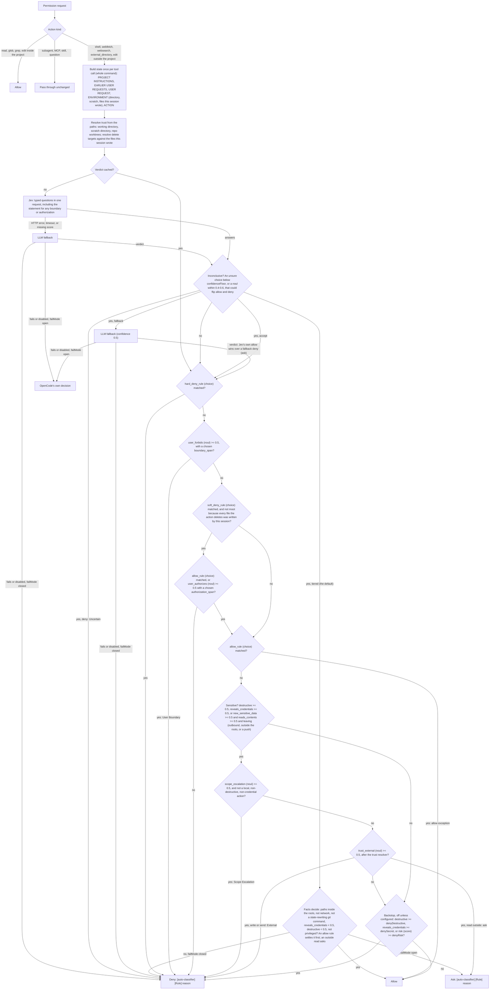

# auto-classifier

An OpenCode plugin that wraps every shell command, file read, and file edit in a
classifier powered by [TypeSafe Jev](https://typesafe.ai) ("System One"), served
through OpenCode Zen or, with `"provider": "openrouter"`, through
[OpenRouter](https://openrouter.ai)'s Decisions API. Both serve the same model
API, so the plugin behaves the same either way.

Before a shell command runs — or a file is read or edited — the plugin sends the
resource to Jev, which answers typed questions about it:

| Question         | Type     | Meaning                                             |
| ---------------- | -------- | --------------------------------------------------- |
| `category`       | `choice` | read / write / vcs / build / network / process / privileged / other |
| `risk`           | `score`  | 0..1 overall risk (legend runs Safe -> Critical)    |
| `destructive`    | `noul`   | probability of irreversible data/system damage      |
| `secret_exposure`| `noul`   | probability of leaking secrets or credentials       |

The verdict is folded into OpenCode's permission evaluation, so an action that
would otherwise auto-run can be escalated to a prompt or blocked. Escalations
are labelled `[auto-classifier] ...` in the permission prompt so their origin is
unambiguous.

By default the plugin is a **risk escalator**: it only ever raises severity.
Setting `"mode": "auto-mode"` makes it behave like Claude Code's auto-mode
classifier instead — rule-based, conversation-aware, and allow/deny (with a
prompt for a sensitive read outside the trusted roots). See
[auto-mode](#auto-mode).

## Installation

The plugin is a normal OpenCode plugin package: the server half is exported at
`.` and the TUI sidebar half at `./tui`. Install it straight from Git — no npm
publish required.

```sh
opencode plugin add github:schemaitat/opencode-plugin-auto-classifier
```

That clones the repo, installs it, and registers it. Verify and update it with:

```sh
opencode plugin list
opencode plugin check
opencode plugin update opencode-plugin-auto-classifier
```

To pin a revision, append a branch, tag, or full commit hash:

```sh
opencode plugin add github:schemaitat/opencode-plugin-auto-classifier#v0.1.0
opencode plugin add git+ssh://git@github.com/schemaitat/opencode-plugin-auto-classifier.git#main
```

Or add it to `opencode.json(c)` by hand. Relative, absolute, and `file://`
paths work too, which is handy for local development:

```jsonc
{
  "$schema": "https://opencode.ai/config.json",
  "plugins": [
    "github:schemaitat/opencode-plugin-auto-classifier"
  ]
}
```

### Requirements

- A paid Jev (System One) key for the selected provider, or the LLM fallback
  (see [Configuration](#configuration)): an inference-scoped OpenCode Console
  key in `OPENCODE_API_KEY` (default `jev` provider), or an OpenRouter key in
  `OPENROUTER_API_KEY` (`openrouter` provider). Without a key the plugin fails
  open by default.
- The TUI sidebar half imports OpenCode's bundled OpenTUI/`solid-js` host
  modules through their runtime ids (`opentui:runtime-module:*`), so it works
  from a `node_modules` install without shipping its own copies. It is optional;
  the server half works alone.

## What it covers

| Permission action | Resource          | State sent to Jev                                |
| ----------------- | ----------------- | ------------------------------------------------ |
| `shell`           | command string    | the command text itself                          |
| `read`            | file path         | `Read the contents of the file at: <path>`       |
| `edit`            | file path         | `Write to or modify the file at: <path>` (edit/write/patch) |

Other actions are ignored.

## Behaviour

- **Escalate, never de-escalate.** The plugin only raises severity
  (`allow` -> `ask` -> `deny`). An explicit `deny` in your config never reaches
  the hook, so it stays final.
- **Action-aware rules.** `shell` uses the general risk score, plus destructive
  and secret signals. `read` only escalates on secret exposure, and `edit` only
  on destruction/secrets — because "risk" is ~100% for *any* write and would
  otherwise prompt on every source edit.
- **Configurable target.** `escalateTo` picks what a triggered threshold becomes:
  `"ask"` (prompt, default) or `"deny"` (allow-or-deny, no prompts).
- **Fail open by default.** If Jev is unreachable the decision is left
  unchanged. Set `"failMode": "closed"` to escalate to `ask` instead.
- **LLM fallback.** When Jev fails (rate limit, timeout, network), the plugin
  re-classifies through `ctx.generate.text` using a normal model
  (`opencode-go/deepseek-v4.1-flash` by default), asking it for the same JSON
  verdict. This runs over OpenCode's own provider transport, so it needs no
  extra key. Disable with `"fallback": false`. If both fail, `failMode` decides.
- **Cache.** Classifications are cached per state string for 5 minutes, so
  repeated commands/paths cost one request.

## Files

- `index.ts` — server plugin: permission hook + `jev_classify_command` tool (and `auto_classifier_rules` in auto-mode).
- `jev.ts` — Jev client (System One request/response, timeouts, abort, classic + auto question sets).
- `verdict.ts` — LLM fallback prompts and verdict parsers (classic and auto), unit-tested.
- `decide.ts` — pure decision logic for the classic mode (thresholds, escalation, `describe`), unit-tested.
- `rules.ts` — auto-mode rule lists, `$defaults` merge, and rule→criteria, unit-tested.
- `context.ts` — auto-mode state assembly (instructions + request + untrusted action), unit-tested.
- `auto.ts` — auto-mode decisions: rule precedence, coverage, authority, the session's user-permission policy, session memo, unit-tested.
- `provenance.ts` — which files this session wrote, and whether a delete only removes them, unit-tested.
- `trust.ts` — deterministic trust resolution for paths, unit-tested.
- `format.ts` — pure sidebar formatting helpers, unit-tested.
- `build.ts` — identifies the running build (installed commit or version) for the sidebar stamp, unit-tested.
- `rpc.ts` — RPC shared with the TUI plugin (`recent` method, `classified` event).
- `tui.ts` — TUI plugin: renders the last classifications in the sidebar.
- `virtual-modules.d.ts` — ambient types for the `opentui:runtime-module:*` host ids.
- `package.json` — `exports` map: `.` → `index.ts`, `./tui` → `tui.ts`.

## Sidebar

The TUI plugin (`tui.ts`) appends a list of the most recent classifications to
the right sidebar (`sidebar.content`). Each line is colour-coded by effect:

| Effect | Colour | Mark |
| ------ | ------ | ---- |
| allow  | green  | `.`  |
| ask    | orange | `?`  |
| deny   | red    | `x`  |

Colours come from the theme's feedback tokens
(`text.feedback.success/error/warning.base`) with explicit hex fallbacks. Lines
read `mark action resource [rule]`, with `(fallback)` appended when the DeepSeek
fallback produced the verdict. The `[rule]` tag is the matched auto-mode rule
(absent in classic mode). Every line ends with `{mode@build}`, e.g.
`{auto-mode@631a3b9}`: the mode and the installed commit (or `v<version>` for a
local checkout) of the plugin instance that decided. A long-running
`opencode serve` can hold instances from several installs at once, so this
shows which one produced each verdict; a line with no stamp came from a build
older than the stamp itself.

Data flows over `rpc.ts`: the server plugin keeps the last 25 entries and emits
a `classified` event per decision; the TUI calls `recent` once, then subscribes
for live updates.


## Configuration

The package name (or a local path) goes in the `plugins` array. Options are
passed through the object form:

```jsonc
{
  "$schema": "https://opencode.ai/config.json",
  "plugins": [
    {
      "package": "github:schemaitat/opencode-plugin-auto-classifier",
      "options": {
        "model": "jev-1.13",
        "apiKey": "oc_sk_...",
        "escalateTo": "deny",
        "askRisk": 1.01,
        "askDestructive": 0.85,
        "askSecret": 0.8,
        "escalate": { "edit": { "destructive": 0.5 } },
        "failMode": "open",
        "debug": false
      }
    }
  ]
}
```

| Option             | Default          | Effect                                                        |
| ------------------ | ---------------- | ------------------------------------------------------------- |
| `mode`             | `classic`        | `auto-mode` emulates Claude Code's auto classifier (see below) |
| `rules`            | `{}`             | auto-mode rule lists: `environment`/`allow`/`soft_deny`/`hard_deny` |
| `conversationContext` | `prompt`      | auto-mode context sent: `none` / `prompt` (last 3 user messages + AGENTS.md) / `session` |
| `confidenceFloor`  | `0.6`            | auto-mode: below this, an answer is uncertain (see `onUncertain`) |
| `onUncertain`      | `tiered` (auto-mode) | auto-mode: an uncertain Jev verdict or fallback answer is decided by the deterministic facts (`tiered`), goes to the LLM fallback (`fallback`), decides on its own answers (`accept`), or is denied as `Uncertain` (`deny`); an unknown value denies |
| `repeatBlocks`     | `{3, 20}`        | auto-mode: consecutive/total blocks before prompting resumes  |
| `provider`         | `jev`            | where Jev is served: `jev` (OpenCode Zen) or `openrouter`     |
| `model`            | per provider     | `jev-1.13` (jev) / `typesafe/jev-1.14` (openrouter)           |
| `endpoint`         | per provider     | Zen System One / OpenRouter Decisions (`/api/alpha/decisions`) |
| `apiKey`           | per provider     | `OPENCODE_API_KEY` (`oc_sk_...`) / `OPENROUTER_API_KEY`       |
| `timeoutMs`        | `10000`          | Whole-request timeout                                         |
| `askRisk`          | `0.7`            | risk >= this -> escalate (`shell` only)                       |
| `askDestructive`   | `0.4`            | destructive >= this -> escalate                               |
| `askSecret`        | `0.8`            | secret exposure >= this -> escalate                           |
| `escalateTo`       | `ask`            | what escalation resolves to: `ask` or `deny`                  |
| `escalate`         | `{}`             | per-action threshold overrides, e.g. `{"edit":{"destructive":0.5}}` |
| `denyDestructive`  | `0.97`           | destructive >= this -> `deny` (`1.01`, off, in auto-mode)     |
| `denySecret`       | `1.01`           | classic: secret exposure; auto-mode: `reveals_credentials` >= this -> `deny` (off by default) |
| `denyRisk`         | `1.01`           | risk >= this -> `deny` (off by default, `shell` only)         |
| `privilegedAsk`    | `true`           | always escalate `priv`/`sudo`-style commands                  |
| `fallback`         | `true`           | use `ctx.generate.text` when Jev fails                        |
| `fallbackModel`    | `opencode-go/deepseek-v4.1-flash` | `provider/model` used for the fallback       |
| `failMode`         | `open`           | `open` leaves the decision unchanged on error; `closed` escalates |
| `cacheTtlMs`       | `300000`         | Classification cache TTL                                      |
| `debug`            | `false`          | Log each classification to `debugLog`                         |
| `debugLog`         | `~/.local/share/opencode/log/auto-classifier.log` | File `debug` appends to (honours `XDG_DATA_HOME`) |

There are two tiers: the `deny*` thresholds always deny, and the `ask*`
thresholds escalate. `escalateTo` decides what an escalation becomes, so
`"escalateTo": "deny"` gives an **allow-or-deny** policy with no prompts.

`escalate` overrides thresholds per action. This matters because scores differ
by action: an ordinary `echo > file` and `edit /etc/passwd` both score ~60%
destructive, so the edit tool needs a lower threshold to be caught.

```jsonc
{
  "escalateTo": "deny",
  "askRisk": 1.01,                     // risk alone never denies (writes score ~100%)
  "askDestructive": 0.85,
  "askSecret": 0.8,
  "escalate": { "edit": { "destructive": 0.5 } },
  "privilegedAsk": true
}
```

## auto-mode

Set `"mode": "auto-mode"` to behave like Claude Code's auto-mode classifier
rather than a score escalator. The differences:

- **Allow, deny, or review.** The classifier *auto-approves* actions that match
  no block rule (this is the point of the profile) and denies the rest. It asks
  only for one case: a sensitive read outside the trusted roots (a log, a
  sibling checkout), which is reviewable rather than forbidden.
- **Rule-based.** Config carries Claude Code's four lists — `environment`,
  `allow`, `soft_deny`, `hard_deny` — as prose entries. Include the literal
  `"$defaults"` to splice in the built-in set.
- **Conversation-aware.** The classifier sees your last three messages, the
  project's `AGENTS.md`, the working directory, and OpenCode's scratch
  directory (`$TMPDIR/opencode`, trusted like the repo, since the agent keeps
  working copies and worktrees there), so explicit intent clears a soft block
  and a stated boundary blocks. Assistant text and tool results are never sent.
- **Hybrid.** Jev answers a parallel question set over the assembled state.
  When Jev fails, the LLM fallback decides. When Jev's verdict is uncertain (an
  answer below `confidenceFloor`, or a yes/no signal near 50%, that could flip
  allow vs deny), `onUncertain` decides: the deterministic facts (`tiered`, the
  default — see below), the LLM fallback, Jev's own answers (`accept`), or a
  denial (`deny`). A near-50% signal that cannot change the outcome (e.g. "did
  the user authorize this?" when no soft rule matched) is not uncertain. Jev's
  uncertain verdict is written to the debug log either way.
- **The fallback is a guess, not a verdict.** Its answers carry confidence 0.5
  and no per-choice confidence, so they are questionable rather than final: a
  fallback denial of something Jev itself allowed becomes a prompt, never a denial. A
  fallback's `user_forbids` and `user_authorizes` need a verbatim
  `boundary_quote` / `authorization_quote` from your requests or the project
  instructions; without one each is discarded. If the fallback model is
  unavailable, the permission message names it.
- **Intent needs evidence.** A boundary or authorization answer counts only when
  the answer also names the statement that backs it. Jev chooses one of your own
  sentences from the project instructions or the last three requests (it does
  not generate text); the fallback must quote one verbatim. A guess with no
  statement behind it is no signal, in either direction. A boundary backed by
  your words denies however uncertain the rest of the verdict is.
- **Provenance is recorded.** The plugin records the files its tools create or
  modify once the call completes. A file this session wrote is regenerable, so
  `Irreversible Local Destruction` (which covers files that existed before the
  session) cannot fire on deleting it, and the model is told the list. An edit
  that failed, or a directory a copy landed in, does not count.
- **Session memory.** A decision is remembered for the session, keyed by the
  session, the assembled state, and the provenance fact, so a repeated check
  costs no request after the classification cache expires either. An allow also
  resets the consecutive-block counter, so one false denial cannot pause
  auto-approval.
- **Trust is resolved, not guessed.** The plugin resolves each path against the
  working directory, the scratch directory, and `git worktree list` entries of
  the repository. The executable itself is a tool, not a data target: `/nix/store/.../bin/node
  eval/run.ts` runs inside the repository, while a script argument (`/etc/run.js`)
  is still resolved and counts. Inside those roots an external claim cannot
  stand, and a local, non-destructive, non-credential action is not
  scope-checked. The model still answers `trust_external` for network commands,
  where only it can see the destination.
- **One decision per command.** OpenCode asks permission for each part of a
  compound command separately. The plugin classifies the whole command once per
  tool call and every part inherits that decision, so `echo ---` in a pipeline
  is judged with the read it follows, and a dangerous part still denies the
  whole command.

Precedence (applied in code): `hard_deny` → deny; a stated boundary → deny;
`soft_deny` → deny unless an `allow` entry matches or you named the action; a
matched `allow` entry → allow; then scope escalation or reaching outside the
trusted environment, which deny only an action that is also destructive,
reveals credentials, or carries new sensitive data out of the environment (a
push counts as leaving; a listing that prints only names does not), and never a
local action that is neither destructive, credential-bearing, nor a push; then
the severity backstop. A read *outside* the roots that carries new data asks
instead of denying. `Irreversible Local Destruction` cannot fire when every
file the action deletes is one this session wrote. Denials are labelled
`[auto-classifier] [<Rule>] ...`.

### Decision flow

Each classified action is one Jev request carrying the typed questions below,
answered in parallel. Jev has three question types: `choice` picks one key from
a set of criteria and reports a confidence; `noul` answers yes/no as a 0–1
probability; `score` places the answer on an ordered scale.

| Question | Type | Decides |
| --- | --- | --- |
| `hard_deny_rule` | choice | a matched `hard_deny` rule denies |
| `user_forbids` | noul | ≥ 0.5 denies as `User Boundary`, when `boundary_span` names a statement |
| `boundary_span` | choice | the context statement that states the boundary, or `none` |
| `soft_deny_rule` | choice | a matched `soft_deny` rule denies unless cleared (and not `Irreversible Local Destruction` when the session wrote every file the action deletes) |
| `allow_rule` | choice | a matched `allow` exception clears a soft rule, and outranks scope and trust, unless the action reveals credentials |
| `user_authorizes` | noul | ≥ 0.5 clears a soft rule, when `authorization_span` names a statement |
| `authorization_span` | choice | the context statement that names and authorizes the action, or `none` |
| `destructive` | noul | ≥ 0.5 makes the action sensitive; ≥ `denyDestructive` denies (off by default) |
| `reveals_credentials` | noul | ≥ 0.5 makes the action sensitive wherever it stays, and stops an `allow` entry from clearing a soft rule; ≥ `denySecret` denies (off by default) |
| `new_sensitive_data` | noul | ≥ 0.5 makes the action sensitive only when it leaves the environment (outbound, outside the roots, or a push) **and** `reads_contents` is ≥ 0.5 |
| `reads_contents` | noul | ≥ 0.5 when the action reads, prints, or sends file contents; a listing that prints only names or metadata is 0, so `ls`/`find` of an outside directory is not new sensitive data |
| `scope_escalation` | noul | ≥ 0.5 on a sensitive action denies, unless the action stays inside the roots, is not destructive or credential-bearing, and does not push |
| `trust_external` | noul | ≥ 0.5 on a sensitive action denies, unless the resolved paths are inside the roots (`ask` for a read outside) |
| `risk` | score | ≥ `denyRisk` denies a shell command (off by default) |
| `category` | choice | logged only |

The two `*_span` questions are offered only when the state has quotable
statements. When the state has none (for example `conversationContext: "none"`),
neither intent signal can fire.



An allow is written back as `allow` unless you have an OpenCode `ask` rule for
the action, which stays a prompt, or repeated blocks have paused auto-approval.
An `ask` is written back as a prompt even when OpenCode would have allowed the
action — that is what makes a sensitive read outside the roots reviewable.
In auto-mode `denyDestructive`, `denySecret`, and `denyRisk` default to `1.01`,
so the backstop is off unless configured: deletion is decided by the rules and
the user's stated intent.

`onUncertain: "tiered"` decides an inconclusive verdict from the facts, not from
the model: a destructive, credential-bearing (`reveals_credentials >= 0.5`),
privileged, or outbound action is not settled by location, nor is a
state-rewriting git command or a `process` action (an install can run code).
A user boundary backed by a quoted statement denies first. Otherwise a matched
allow rule settles it, an action inside the roots is allowed, and a read outside
the roots asks. An LLM fallback's verdict carries confidence 0.5, so it is
inconclusive too and takes this path unless `onUncertain` is `accept` (where its
answers stand). This is why a fallback model that does not exist no longer turns
a local `pytest` run into a denial. Set `onUncertain` to `fallback`, `accept`,
or `deny` to choose another policy; `fallback` never calls the fallback twice.

Trust is resolved before the model's answer is read: the plugin canonicalises the
working directory, the scratch directory, and `git worktree list --porcelain`
entries of the repository, then resolves the arguments and redirection targets
of every command. The executable is not a data target, and neither is the word
after a wrapper such as `env`, `sudo`, `command`, or `time`, so an absolute
interpreter path does not make an in-repo command external. A script argument
still counts. Inside those roots `trust_external` is treated as 0 and a local,
non-destructive, non-credential action is not scope-checked. The model still
decides `trust_external` for `webfetch`, `websearch`, and commands it classifies
as `network`.

Review scope follows Claude Code: `shell`, `webfetch`, `websearch`,
`external_directory`, and edits **outside** the working directory are
classified; `read`/`glob`/`grep` and in-project edits are auto-allowed; other
actions pass through.

```jsonc
{
  "plugins": [
    {
      "package": "github:schemaitat/opencode-plugin-auto-classifier",
      "options": {
        "mode": "auto-mode",
        "rules": {
          "soft_deny": ["$defaults", "Team rule: never modify infra/terraform/prod/"]
        },
        "conversationContext": "prompt"
      }
    }
  ]
}
```

Two safety behaviors: auto-mode defaults to `failMode: "closed"` (an action it
cannot classify is denied, matching Claude Code), and a user-configured OpenCode
`ask` rule is left as a prompt rather than being auto-approved or denied. After
too many blocks (`repeatBlocks`, default 3 consecutive / 20 total) auto-approval
pauses so prompts resume.

The user's rules come from the session's effective ruleset
(`Session.Info.permissions`, which OpenCode evaluates after the agent's rules):
a non-wildcard `allow` rule auto-approves even when OpenCode would prompt, and an
`ask` rule keeps its prompt. The shipped `{"action":"*","resource":"*"}` base
policy says nothing, so it is not treated as an allow. If the ruleset cannot be
read, the plugin keeps OpenCode's prompt rather than assuming the user has no
policy, and logs `session permission rules unavailable`. A saved "allow always"
approval lives in OpenCode's project-level saved approvals, not in that ruleset,
and the plugin API does not expose it; auto-mode therefore does not see it as a
user allow rule.

The tool `auto_classifier_rules` prints the effective, merged rule lists (parity
with `claude auto-mode defaults`). `denyDestructive`/`denySecret`/`denyRisk`
become the severity backstop; the `ask*` thresholds, `escalate`, `escalateTo`,
and `privilegedAsk` are ignored in auto-mode.

## Tool

The plugin registers `jev_classify_command` so the model or a human can classify
any command on demand:

```
jev_classify_command({ "command": "rm -rf ./build" })
```

## Examples (live results)

| Action | Resource                         | Category | Risk | Destructive | Secret | Effect |
| ------ | -------------------------------- | -------- | ---- | ----------- | ------ | ------ |
| shell  | `git status --short`             | vcs      | 1%   | 1%          | 18%    | allow  |
| shell  | `cat .env`                       | read     | 5%   | 1%          | 97%    | ask    |
| shell  | `git push --force origin main`   | vcs      | 100% | 92%         | 23%    | ask    |
| shell  | `rm -rf /`                       | write    | 100% | 98%         | 8%     | deny   |
| read   | `~/.secrets.zshrc`               | read     | 13%  | 1%          | 93%    | ask    |
| read   | `/home/dev/.zshrc.secrets`       | read     | 23%  | 1%          | 96%    | ask    |
| read   | `/home/dev/opencode.jsonc`       | read     | 1%   | 1%          | 30%    | allow  |
| edit   | `/etc/passwd`                    | write    | 100% | 61%         | 15%    | ask    |
| edit   | `index.ts` (source)              | write    | 100% | 29%         | 30%    | allow  |

## Notes

- Jev is **not** an LLM and does not stream; each call adds roughly 200-500 ms
  (cached afterwards). That latency is paid only when a permission is evaluated.
- Only two paths exist: **paid Jev** or the **LLM fallback**. There is no free
  model default.
- The paid model needs an inference-scoped Console API key (`oc_sk_...`) passed
  as `apiKey` or `OPENCODE_API_KEY`. A key without model permission returns
  `403 "This API key can't call models"`, and the Console OAuth token is
  rejected by the zen endpoint (`401 "Invalid API key."`).
- With `"provider": "openrouter"`, Jev is called through OpenRouter's Decisions
  API (`https://openrouter.ai/api/alpha/decisions`) with the same typed
  questions, using an OpenRouter key from `apiKey` or `OPENROUTER_API_KEY`. Each
  provider reads only its own key. The Decisions API is an **alpha** endpoint,
  so its path or shape may change. Set `"model": "~typesafe/jev-latest"` to
  follow new Jev releases instead of pinning one.
- The DeepSeek fallback is a normal LLM call, so it is slower and consumes the
  fallback model's quota; it only runs after a Jev failure or, with
  `onUncertain: "fallback"`, an uncertain auto-mode verdict.

## Development

The pure logic is split out so it can be tested without the OpenCode runtime:
`decide.ts` (classic thresholds and escalation rules), `rules.ts` (auto-mode rule
lists and `$defaults` merge), `context.ts` (auto-mode state assembly and the
quotable statements), `auto.ts`
(auto-mode precedence, coverage, authority, and the session memo), `provenance.ts`
(session file provenance and delete-target parsing), `trust.ts` (deterministic path
resolution against the working directory, scratch directory, and repo
worktrees), `format.ts` (sidebar rendering), `jev.ts` (the System One client,
tested with an injected `fetch`), and `verdict.ts` (the fallback prompts and
parsers). `test/plugin.test.ts` runs the real `setup` against a fake `ctx`, so
the permission hook's user-rule path is exercised without a key or a network.

```sh
npm test          # node --test, no dependencies
npm run test:watch
```

Tests use Node's built-in test runner and Node's native TypeScript type
stripping, so there is nothing to build and no dev dependencies to install.

## Fallback

```
paid Jev (System One)  --429/timeout/error-->  ctx.generate.text(fallbackModel)
```

The fallback prompt asks for strict JSON
(`{"category":…,"risk":0..1,"destructive":0..1,"secret_exposure":0..1}`), which
is parsed and fed through the same `decide()` rules. A verdict with a missing
or non-numeric score counts as a failure, leaving the decision to `failMode`,
rather than as a score of 0. The action is sent JSON-encoded and marked as
untrusted data, so text inside a command cannot pose as classifier
instructions. The resulting decision is
tagged `via=fallback` so it is visible in debug logs and permission messages.

In auto-mode the fallback gets the auto prompt instead (rule labels, trust,
intent, and both exposure questions) and its answer is marked confidence 0.5
with no per-choice confidence. A fallback `user_forbids` without a verbatim
`boundary_quote` from the context is discarded, and a fallback denial of
something Jev allowed becomes a prompt rather than a block. If the fallback
model itself is unavailable, the permission message names it.
